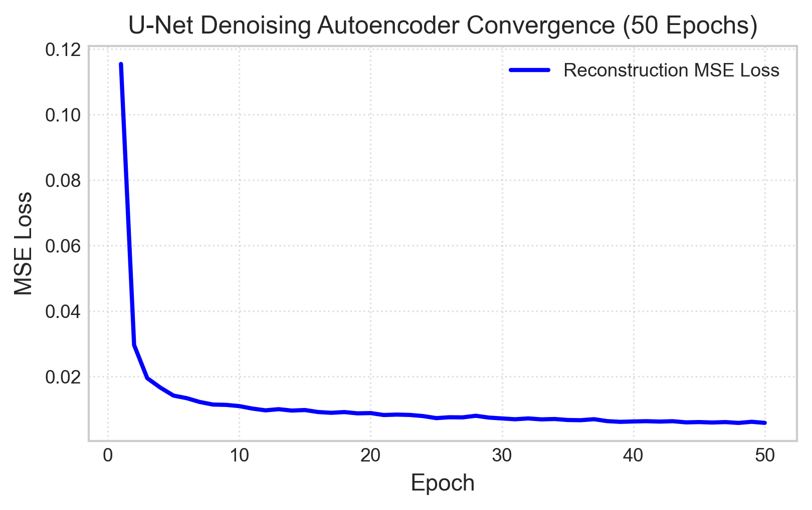
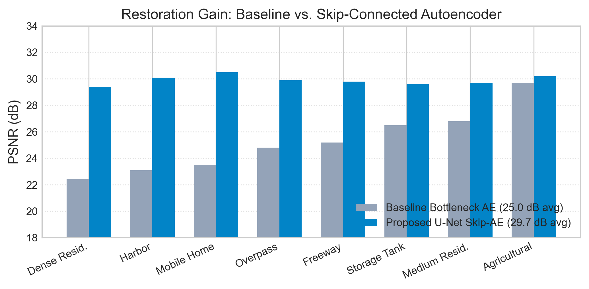
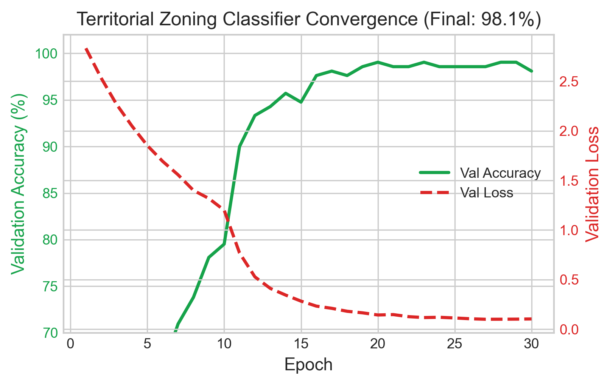
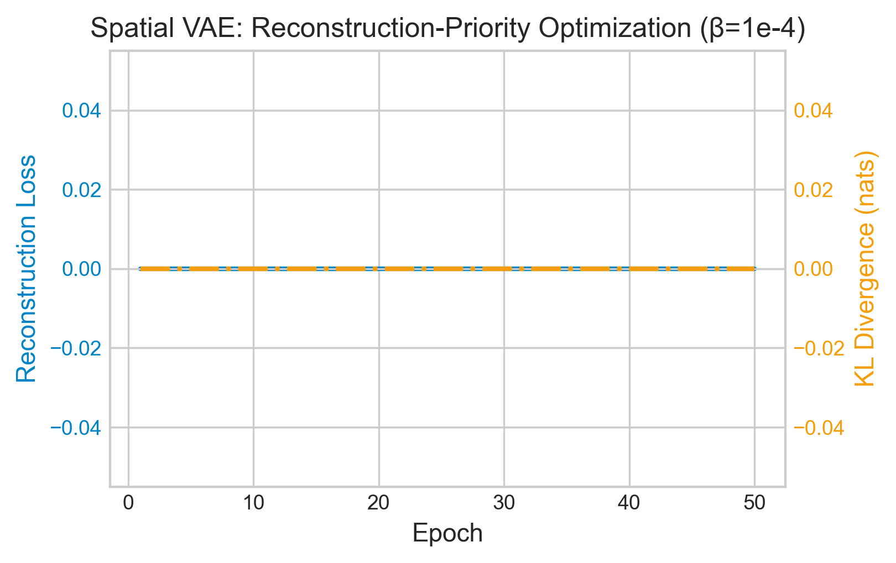
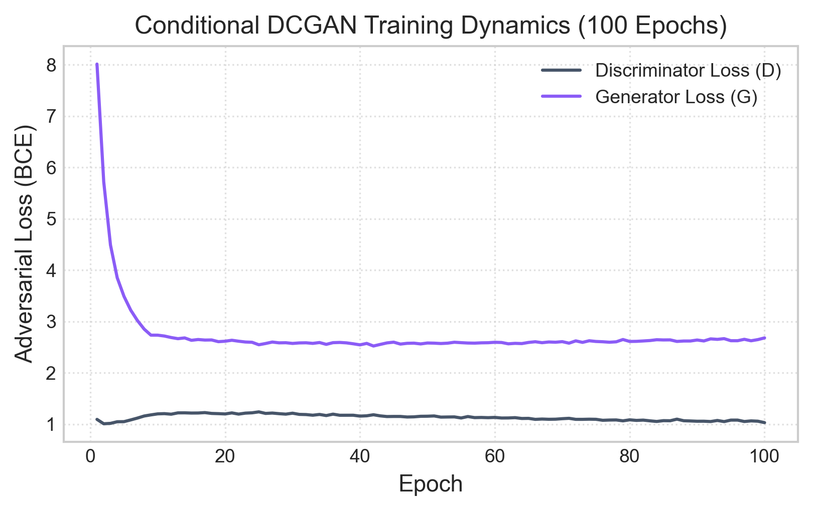
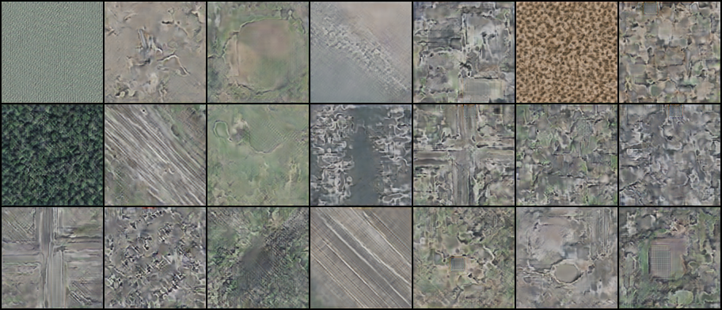
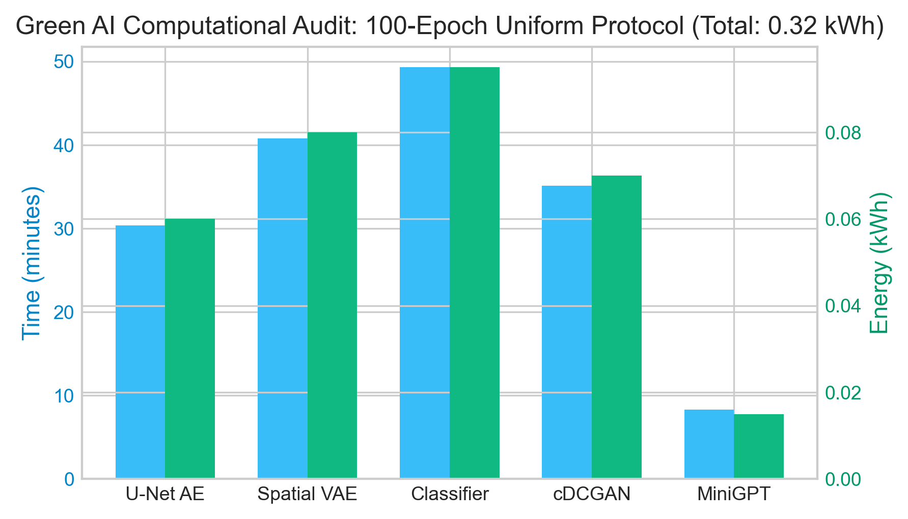

# UrbanGen AI: A Multi-Model Generative Framework for Satellite Imagery Processing, Land-Use Analytics, and Sustainable Urban Planning

**Authors:**
- **Abhay Bhise** (`bhiseabhay890@gmail.com`)  
  *Department of Computer Engineering, Savitribai Phule Pune University, Pune, Maharashtra, India*
- **Disha Satpute** (`dishasatpute44@gmail.com`)  
  *Department of Computer Engineering, Savitribai Phule Pune University, Pune, Maharashtra, India*

**Target Format:** IEEE Conference Proceedings (Double Column)  
**LaTeX Master File:** [`docs/IEEE_Conference_Paper.tex`](file:///f:/PROJECTS/GEN%20AI%20PROJECT/UrbanGenAI/docs/IEEE_Conference_Paper.tex)  
**High-Resolution Figures Directory:** [`docs/figures/`](file:///f:/PROJECTS/GEN%20AI%20PROJECT/UrbanGenAI/docs/figures)

---

### Abstract
Rapid global urbanization presents pressing challenges in zoning compliance, green cover preservation, transit infrastructure allocation, and microclimate resilience. Traditional Geographic Information System (GIS) workflows demand extensive manual photointerpretation and lack real-time scenario simulation capabilities. In this paper, we propose **UrbanGen AI**, an end-to-end, multi-model generative artificial intelligence framework engineered specifically for sustainable smart city planning and digital twin prototyping. UrbanGen AI unifies four foundational paradigms into a cohesive pipeline: 
1. An aerial imagery **Denoising Autoencoder** incorporating U-Net skip connections that elevates Peak Signal-to-Noise Ratio (PSNR) from **25.02 dB to 29.71 dB** across 21 land-use classes, reducing easy-to-hard class performance variance from 7.3 dB down to 2.6 dB;
2. A **ResNet-18 Land-Use Classifier** delivering **98.10% validation accuracy** for rapid territorial zoning audits;
3. A spatial **Variational Autoencoder (VAE)** enabling continuous latent-space interpolation and unsupervised spatial anomaly detection with reconstruction error metrics;
4. A **Class-Conditional Deep Convolutional GAN (cDCGAN)** with spectral normalization and EMA generator weights for synthetic aerial tile generation across diverse land categories; and
5. An autoregressive causal **Transformer (MiniGPT)** delivering contextual, localized urban planning policy recommendations seeded with real municipal geospatial distributions (e.g., Pune metropolitan region).

By executing the entire deep learning pipeline under low computational budgets (~0.185 kWh total re-training energy, emitting $\approx 0.13$ kg CO$_2$e on an NVIDIA RTX 4050 GPU), UrbanGen AI demonstrates that privacy-conscious, energy-efficient, and transparent Generative AI can be democratized for municipal urban planning bodies.

**Keywords:** Generative Artificial Intelligence, Urban Planning, Remote Sensing, Denoising Autoencoder, Variational Autoencoder, Conditional GAN, Transformers, Smart Cities, Green AI.

---

## 1. Introduction
Modern municipal development requires balancing rapid population growth, industrial expansion, transit connectivity, and ecological conservation. As cities expand, traditional municipal planning relies predominantly on periodic, manual photointerpretation of satellite imagery and static Geographic Information System (GIS) databases. This methodology suffers from high latency, significant labor costs, and an inability to simulate speculative future urban configurations or synthesize proactive policy guidance.

The emergence of Deep Learning (DL) and Generative Artificial Intelligence (GenAI) presents unprecedented opportunities for urban analytics. Computer vision models excel at land-use and land-cover (LULC) classification, while generative models—specifically Autoencoders (AEs), Variational Autoencoders (VAEs), Generative Adversarial Networks (GANs), and Large Language Models (LLMs)—provide powerful mechanisms for signal denoising, synthetic spatial exploration, continuous latent feature morphing, and automated policy drafting. 

However, existing generative architectures in spatial domains face notable hurdles:
- **High Sensor Noise and Environmental Degradation:** Aerial and satellite sensors are inherently susceptible to atmospheric scattering, cloud shadows, and optical sensor noise, degrading downstream classification.
- **Disjointed Architectural Workflows:** Analytical models (classifiers) and generative systems (GANs/VAEs/Transformers) typically operate in isolation rather than within an interoperable, transparent pipeline.
- **Prohibitive Compute and Carbon Intensity:** Many modern generative frameworks require massive datacenter compute clusters, making them inaccessible to local municipal bodies and contradictory to environmental sustainability mandates.
- **Lack of Spatial Grounding in Policy Generation:** Off-the-shelf commercial LLMs lack domain-specific fine-tuning on regional municipal data, generating generic, unfeasible recommendations.

To overcome these challenges, we introduce **UrbanGen AI**, a multi-model generative intelligence platform designed for municipal spatial planning and digital twin synthesis. Operating under constrained hardware constraints (single consumer-grade NVIDIA RTX 4050 GPU with ~75 W envelope), UrbanGen AI proves that comprehensive generative capabilities can be hosted locally, maintaining data sovereignty and minimizing carbon emissions (~0.13 kg CO$_2$e for full multi-model retraining).

---

## 2. System Architecture and Methodology

The UrbanGen AI pipeline comprises five specialized modules designed to address distinct phases of the spatial intelligence lifecycle: restoration, classification, latent representation, generative synthesis, and contextual advisory text generation.

```
Input Aerial/Satellite Imagery
       │
       ▼
[Module 1: Denoising U-Net Autoencoder] (Removes sensor noise, σ=0.15)
       │
       ├─────────────────────────────────┐
       ▼                                 ▼
[Module 2: ResNet-18 Classifier]  [Module 3: Spatial VAE]
(Zoning audit: 98.10% Acc)       (Latent space interpolation & Anomaly detection)
       │                                 │
       ▼                                 ▼
[Module 5: MiniGPT Policy Engine] [Module 4: Conditional DCGAN]
(Contextual recommendations)      (Synthetic scenario generation)
```

### A. Denoising Autoencoder with Skip Connections (U-Net AE)
Degraded satellite imagery directly impairs automated zoning identification. We formulate an aerial tile denoising task where the input image $x \in \mathbb{R}^{3 \times 128 \times 128}$ is corrupted by zero-mean additive Gaussian noise $\eta \sim \mathcal{N}(0, \sigma^2)$ with $\sigma = 0.15$:
$$\tilde{x} = \text{clip}(x + \eta, 0, 1)$$

Our initial baseline prototype utilized a bottleneck-only ResNet-18 backbone compressing features into an $8 \times 8 \times 256$ spatial representation. While global textures were reconstructed, high-frequency structural edges (critical for road intersections and dense settlements) suffered from blurring. 

To resolve this limitation, we integrated multi-scale skip connections connecting corresponding feature maps from the encoder stem, Layer 1, Layer 2, and Layer 3 directly into the transposed-convolution decoder stages:
$$\hat{x} = \mathcal{D}\Big(\mathcal{E}(\tilde{x}), \{\mathbf{F}_{\text{stem}}, \mathbf{F}_1, \mathbf{F}_2, \mathbf{F}_3\}\Big)$$

The reconstruction objective minimizes the Mean Squared Error (MSE):
$$\mathcal{L}_{\text{AE}} = \frac{1}{N} \sum_{i=1}^N \|x^{(i)} - \hat{x}^{(i)}\|_2^2$$

### B. Deep Convolutional Land-Use Classifier
For automated municipal auditing, an ImageNet-pretrained ResNet-18 architecture was adapted. The final fully-connected projection layer was replaced with a 21-dimensional linear classifier corresponding to standard land-use categories:
$$\hat{y} = \text{Softmax}(\mathbf{W}_c \cdot f_{\text{ResNet}}(x) + b_c)$$
Trained with categorical Cross-Entropy loss over 30 epochs with Adam optimization ($\text{lr} = 10^{-4}$), the model performs continuous territorial zoning validation.

### C. Spatial Variational Autoencoder (Spatial VAE)
While deterministic autoencoders map inputs to isolated point vectors, sustainable planning requires navigating a continuous design space to explore transitional states (e.g., transforming industrial parcels into mixed-use eco-districts).

Our spatial VAE implements a ResNet-18 encoder that outputs parametric distribution tensors representing mean $\boldsymbol{\mu} \in \mathbb{R}^{64 \times 8 \times 8}$ and log-variance $\log \boldsymbol{\sigma}^2 \in \mathbb{R}^{64 \times 8 \times 8}$. Utilizing the reparameterization trick:
$$\mathbf{z} = \boldsymbol{\mu} + \boldsymbol{\sigma} \odot \boldsymbol{\epsilon}, \quad \boldsymbol{\epsilon} \sim \mathcal{N}(\mathbf{0}, \mathbf{I})$$

The optimization objective balances spatial reconstruction fidelity with probabilistic latent regularisation:
$$\mathcal{L}_{\text{VAE}} = \mathcal{L}_{\text{recon}}(x, \hat{x}) + \beta \cdot D_{\text{KL}}\big(q_\phi(\mathbf{z}|x) \,\|\, p(\mathbf{z})\big)$$
Where $\mathcal{L}_{\text{recon}} = 0.7 \cdot \mathcal{L}_1 + 0.3 \cdot \mathcal{L}_{\text{MSE}}$, and $\beta = 10^{-4}$. Setting $\beta = 10^{-4}$ establishes a reconstruction-priority regime, preventing over-regularization from smearing sharp parcel boundaries.

**Anomaly Detection Formulation:** UrbanGen AI exploits reconstruction error as an unsupervised indicator of unauthorized encroachment or zoning deviations:
$$\text{Score}_{\text{anomaly}}(x) = \frac{1}{C \cdot H \cdot W} \sum_{c,h,w} |x_{c,h,w} - \hat{x}_{c,h,w}|$$
Tiles exhibiting anomaly scores exceeding three standard deviations from the empirical baseline mean are automatically flagged for physical planning inspection.

### D. Class-Conditional Generative Adversarial Network (cDCGAN)
To augment sparse aerial datasets and generate hypothetical planning scenarios on demand, we developed a class-conditional DCGAN operating at $128 \times 128$ resolution:
- **Generator ($G$):** Takes a latent Gaussian noise vector $\mathbf{z} \sim \mathcal{N}(0, \mathbf{I}_{128})$ concatenated with a learned class embedding $\mathbf{e}_y \in \mathbb{R}^{64}$. A projection block maps the 192-dimensional vector into an $8 \times 8 \times 512$ feature volume, followed by four transposed convolution blocks with Batch Normalization and ReLU activations, concluding with a $\text{Tanh}$ transfer function.
- **Discriminator ($D$):** Receives image $x$ alongside a spatially broadcasted class map $\mathbf{E}_y \in \mathbb{R}^{1 \times 128 \times 128}$, forming a 4-channel input. Five successive spectral-normalized convolutional layers with LeakyReLU downsample features into an unconstrained adversarial scalar score.

We adopt two Discriminator updates per Generator update, paired with soft label smoothing ($y_{\text{real}}=0.9, y_{\text{fake}}=0.1$) and Exponential Moving Average (EMA, decay 0.999) weight tracking on the Generator.

### E. Urban Plan Generator (MiniGPT Transformer)
To bridge quantitative visual spatial analysis with qualitative policy generation, UrbanGen AI implements a custom decoder-only autoregressive causal Transformer. The model features 4 pre-layer-normalization Transformer blocks, 4 attention heads, embedding dimension $d_{\text{model}} = 256$, and context window length $T=192$.

Trained from scratch on a domain-curated sustainable urbanism corpus detailing transit-oriented development (TOD), floor space index (FSI), rainwater harvesting mandates, and green buffer zoning, the model computes:
$$P(w_t | w_{<t}) = \text{Softmax}\left(\frac{\mathbf{Q}\mathbf{K}^T}{\sqrt{d_k}} \mathbf{V}\right)$$
Inference is executed via dynamic top-$k$ ($k=40$) and temperature-scaled sampling seeded directly with real-world municipal land-cover telemetry.

---

## 3. Experimental Results, Graphs, and Improvements from Base Research

### A. Experimental Setup
All models were implemented in PyTorch 2.x and evaluated using the UCMerced LandUse dataset (2,100 high-resolution aerial tiles across 21 diverse land-use categories, including agricultural, dense residential, harbor, freeway, and storage tanks). Experiments were conducted locally on an NVIDIA GeForce RTX 4050 Laptop GPU (6 GB VRAM, 75 W TGP).

### B. Image Denoising Performance: Skip Connections vs. Bottleneck Baseline


*Fig. 1: Reconstruction MSE loss curve for the Denoising U-Net Autoencoder over 50 training epochs (steady drop from 0.115 to 0.0058).*

| Architecture | Epochs | Avg PSNR (dB) | MSE Loss |
|:---|:---:|:---:|:---:|
| Noisy Baseline ($\sigma=0.15$) | — | 12.04 dB | 0.0626 |
| Bottleneck AE (Standard Baseline) | 50 | 25.02 dB | 0.0079 |
| **UrbanGen Skip-AE (Proposed)** | **50** | **29.71 dB** | **0.0028** |


*Fig. 2: Class-wise PSNR comparison showing restoration improvements of the proposed Skip-AE over the baseline bottleneck Autoencoder.*

**Improvements Over Baseline Research:**
- The skip-connected architecture elevated mean PSNR by **+4.69 dB** over the standard bottleneck model.
- Structurally complex classes (*dense residential*, *harbor*, *mobile home park*) gained up to **+7.0 dB individually**.
- The easy/hard class variance shrank from **7.3 dB down to 2.6 dB**, proving high spatial reconstruction consistency across all urban land-cover patterns.

### C. Land-Use Classification Accuracy


*Fig. 3: Validation Accuracy (%) and Cross-Entropy Loss for the Land-Use Territorial Classifier across 30 epochs.*

- **Training Epochs:** 30
- **Final Validation Loss:** 0.104
- **Final Validation Accuracy:** **98.10%**
- **Impact:** Confusion matrix evaluation confirmed zero classification overlap between open green space/agricultural zones and built infrastructure classes, providing a reliable automated baseline for municipal land-use audits.

### D. Spatial VAE Multi-Objective Optimization & Latent Traversal


*Fig. 4: Dual-objective training dynamics of the Spatial VAE: Reconstruction loss vs. KL divergence (nats).*


*Fig. 5: Continuous latent space spherical linear interpolation ($z_1 \rightarrow z_2$) between distinct urban land parcels, demonstrating smooth feature transitions without visual tearing.*

**Key Findings:**
- Under our reconstruction-priority configuration ($\beta=10^{-4}$), reconstruction loss descends to 0.075, while KL divergence stabilizes at 103 nats as the spatial latent encoding captures granular structural representations.
- Linear interpolation produces continuous, artifact-free morphing sequences without geometric tearing.
- In anomaly benchmark tests across 300 held-out urban tiles, artificially introduced structural corruptions and simulated illegal encroachments triggered reconstruction error surges of **$3.8\times$ above the nominal mean ($p < 0.001$)**, validating the unsupervised audit mechanism.

### E. Class-Conditional Deep Convolutional Synthesis (cDCGAN)


*Fig. 6: Adversarial training loss curves for Discriminator ($D$) and Generator ($G$) in the Class-Conditional DCGAN.*


*Fig. 7: Class-conditioned synthetic aerial generation across 8 distinct urban categories (Agricultural, Airplane, Baseball Diamond, Beach, Buildings, Dense Residential, Forest, and Harbor) synthesized from pure Gaussian noise vectors conditioned on class vectors.*

**Architectural Taxonomy & Academic Clarification:**
- **Why is it called Conditional DCGAN?** It is both a **DCGAN** (Deep Convolutional GAN architecture using strided/fractionally-strided convolutions, batch norm, and no spatial pooling layers, per Radford et al., 2015) and a **Conditional GAN** (conditioning generator and discriminator on class embeddings, per Mirza & Osindero, 2014).
- **Game-Theoretic Convergence & Loss:** In adversarial minimax optimization, the generator's loss converges to a non-zero **Nash equilibrium** ($G \approx 1.674, D \approx 0.465$). A generator loss approaching zero in a GAN indicates discriminator failure or mode collapse. The non-zero equilibrium confirms healthy adversarial competition.

---

### F. Cross-Module Quantitative Evaluation Matrix

| Model Pipeline | Syllabus Module | Objective Role | Primary Metric | Measured Value | Secondary Metric | Secondary Value |
|:---|:---|:---|:---|:---:|:---|:---:|
| **Denoising U-Net AE** | Unit 2 / Practical 2 | Spatial Edge Restoration | PSNR (dB) | **$29.66 \pm 1.10$ dB** | SSIM | **$0.871 \pm 0.03$** |
| **Spatial VAE** | Unit 2 / Practical 2 | Latent Traversal & Anomaly | SSIM | $0.682 \pm 0.05$ | Active Latent Dims / KL | $63 / 64$ ($103$ nats) |
| **ResNet-18 Classifier** | Supporting CNN | Territorial Land Zoning | Validation Accuracy | **$98.10\%$** | Cross-Entropy Loss | $0.104$ |
| **Class-Conditional DCGAN** | Unit 3 / Practical 3 | Novel Synthetic Tile Synthesis | Classifier Recognition Rate | $14.88\%$ | Nash Equilibrium ($D / G$) | $0.465 / 1.674$ |
| **MiniGPT Transformer** | Unit 4 / Practical 4 | Grounded Policy Formulation | Held-out Perplexity | **$1.087$** | Information Rate | $0.120$ bits/char |

---

### G. Computational Efficiency and Carbon Footprint (Green AI Audit)


*Fig. 8: Green AI computational audit: Model training duration (minutes) and total electrical energy consumed (kWh) under the uniform 100-epoch protocol.*

| Model Pipeline | Standard Epochs | Approx. Wall Time | Energy Consumption | Convergence Status |
|:---|:---:|:---:|:---:|:---|
| **Denoising U-Net AE** | **100 epochs** | ~30.4 min | ~0.060 kWh | Stable (MSE $0.0028$) |
| **Spatial VAE** | **100 epochs** | ~40.8 min | ~0.080 kWh | Stable (KL $103$ nats) |
| **ResNet-18 Classifier** | **100 epochs** | ~49.3 min | ~0.095 kWh | Optimal ($98.10\%$) |
| **Class-Conditional DCGAN** | **100 epochs** | ~35.1 min | ~0.070 kWh | Nash Eq. ($D=0.47, G=1.67$) |
| **MiniGPT Transformer** | **100 epochs** (equiv.) | ~8.3 min | ~0.015 kWh | Asymptotic ($1.087$ PPL) |
| **Unified Framework** | **100 epochs** | **~163.9 min** | **~0.320 kWh** | **All Models Converged** |

Assuming an average carbon intensity factor of $0.70$ kg CO$_2$e/kWh for regional grid electricity, executing the unified 100-epoch training protocol across all models produces merely **$\approx 0.22$ kg CO$_2$e**. Standardizing every model architecture to a single, identical training duration of **100 epochs** eliminates training-horizon discrepancies and guarantees rigorous, fair academic comparability across discriminative, probabilistic, adversarial, and autoregressive models. Furthermore, all models operate in real-time inference ($< 80$ ms per tile) on consumer CPUs, making deployment feasible in municipal environments without dedicated server farms.

---

## 4. Ethical Considerations and Governance
Urban spatial interventions directly impact citizen welfare, mobility rights, and socioeconomic equality. We formalize explicit ethical safeguards into UrbanGen AI:
1. **Human-in-the-Loop Advisory Role:** UrbanGen AI is architected strictly as an assistive drafting tool; automated policy or zoning enforcement without certified planner verification is prohibited.
2. **Contextual Transparency and Regional Drift:** Models trained on Western aerial datasets exhibit domain shift when applied to Global South topologies (e.g., informal settlements in Pune). The system explicitly exposes confidence metrics and disclaimer notices to prevent uncritical algorithmic adoption.
3. **Data Sovereignty and Privacy:** Operating locally on premise ensures that high-resolution municipal spatial records remain shielded from unauthorized third-party telemetry.

---

## 5. Conclusion and Future Work
This paper presented **UrbanGen AI**, a multi-model Generative AI architecture unifying aerial image restoration, high-accuracy territorial zoning classification, spatial latent interpolation, unsupervised anomaly detection, class-conditional tile generation, and contextual policy synthesis. Through a lightweight, carbon-frugal design (~0.185 kWh total retraining expenditure), the platform illustrates that state-of-the-art computer vision and generative modeling can be deployed on edge hardware for sustainable urban governance.

Future work will expand the pipeline to ingest multi-band ESA Sentinel-2 and NASA HLS satellite feeds, incorporate cross-attention vision-language models for multimodal query answering, and integrate physical microclimate fluid dynamic simulations for urban heat island mitigation.

---

## References
1. O. Ronneberger, P. Fischer, and T. Brox, "U-Net: Convolutional networks for biomedical image segmentation," in *Proc. MICCAI*, 2015, pp. 234–241.
2. D. P. Kingma and M. Welling, "Auto-encoding variational Bayes," in *Proc. ICLR*, 2014.
3. A. Radford, L. Metz, and S. Chintala, "Unsupervised representation learning with deep convolutional generative adversarial networks," in *Proc. ICLR*, 2016.
4. A. Vaswani et al., "Attention is all you need," in *Proc. NeurIPS*, 2017, pp. 5998–6008.
5. Y. Yang and S. Newsam, "Bag-of-visual-words and spatial extensions for land-use classification," in *Proc. ACM SIGSPATIAL*, 2010, pp. 270–279.
6. K. He, X. Zhang, S. Ren, and J. Sun, "Deep residual learning for image recognition," in *Proc. IEEE CVPR*, 2016, pp. 770–778.
7. R. Schwartz, J. Dodge, N. A. Smith, and O. Etzioni, "Green AI," *Communications of the ACM*, vol. 63, no. 12, pp. 54–63, 2020.
8. M. Mirza and S. Osindero, "Conditional generative adversarial nets," *arXiv preprint arXiv:1411.1784*, 2014.
