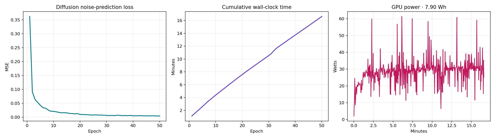

# UrbanGen AI: A Multi-Model Generative Framework for Satellite Imagery Processing, Land-Use Analytics, and Sustainable Urban Planning

**Authors:**
- **Abhay Bhise** (`bhiseabhay890@gmail.com`)  
  *Department of Computer Engineering, Savitribai Phule Pune University, Pune, Maharashtra, India*
- **Disha Satpute** (`dishasatpute44@gmail.com`)  
  *Department of Computer Engineering, Savitribai Phule Pune University, Pune, Maharashtra, India*

**Target Format:** IEEE Conference Proceedings (Double Column)  
**LaTeX Master File:** [`docs/IEEE_Conference_Paper.tex`](file:///f:/PROJECTS/GEN%20AI%20PROJECT/UrbanGenAI/docs/IEEE_Conference_Paper.tex)  
**High-Resolution Figures Directory:** [`docs/figures/`](file:///f:/PROJECTS/GEN%20AI%20PROJECT/UrbanGenAI/docs/figures)

---

### Abstract
Rapid global urbanization presents pressing challenges in zoning compliance, green cover preservation, transit infrastructure allocation, and microclimate resilience. Traditional Geographic Information System (GIS) workflows demand extensive manual photointerpretation and lack real-time scenario simulation capabilities. In this paper, we propose **UrbanGen AI**, an end-to-end, multi-model generative artificial intelligence framework engineered specifically for sustainable smart city planning and digital twin prototyping. UrbanGen AI implements the five generative model families required by the Generative Artificial Intelligence syllabus—Autoencoder, Variational Autoencoder, Generative Adversarial Network, Transformer-based generator, and Diffusion Model—within one auditable pipeline:
1. An aerial imagery **Denoising Autoencoder** incorporating U-Net skip connections, evaluated with reconstruction metrics on representative UCMerced tiles;
2. A spatial **Variational Autoencoder (VAE)** enabling continuous latent-space interpolation and unsupervised spatial anomaly detection with reconstruction error metrics;
3. A **Class-Conditional Deep Convolutional GAN (cDCGAN)** with spectral normalization and EMA generator weights for synthetic aerial tile generation across diverse land categories;
4. An autoregressive causal **Transformer (MiniGPT)** delivering contextual, localized urban planning policy recommendations seeded with real municipal geospatial distributions (e.g., Pune metropolitan region); and
5. A class-conditional **Denoising Diffusion Probabilistic Model (DDPM)** with a DDIM sampler for novel target-class aerial-tile generation.

An independently trained **ResNet-18 land-use classifier** is used only as a supporting zoning and generated-image evaluation component; it is not counted as an additional generative model family.

The system is designed to run locally on a consumer NVIDIA RTX 4050 GPU. Energy and carbon claims are intentionally not reported until measured with a reproducible hardware-level protocol.

The paper follows the supplied Generative Artificial Intelligence syllabus boundary: the reported generative families are AE, VAE, GAN, Transformer/GPT, and Diffusion. No additional generative architecture is introduced. The land-use classifier is retained as a conventional discriminative support model because it supplies zoning labels and independent target-compliance checks.

**Keywords:** Generative Artificial Intelligence, Urban Planning, Remote Sensing, Denoising Autoencoder, Variational Autoencoder, Conditional GAN, Transformer, Diffusion Model, Smart Cities, Green AI.

---

## 1. Introduction
Modern municipal development requires balancing rapid population growth, industrial expansion, transit connectivity, and ecological conservation. As cities expand, traditional municipal planning relies predominantly on periodic, manual photointerpretation of satellite imagery and static Geographic Information System (GIS) databases. This methodology suffers from high latency, significant labor costs, and an inability to simulate speculative future urban configurations or synthesize proactive policy guidance.

The emergence of Deep Learning (DL) and Generative Artificial Intelligence (GenAI) presents unprecedented opportunities for urban analytics. Computer vision models excel at land-use and land-cover (LULC) classification, while generative models—specifically Autoencoders (AEs), Variational Autoencoders (VAEs), Generative Adversarial Networks (GANs), and Large Language Models (LLMs)—provide powerful mechanisms for signal denoising, synthetic spatial exploration, continuous latent feature morphing, and automated policy drafting. 

However, existing generative architectures in spatial domains face notable hurdles:
- **High Sensor Noise and Environmental Degradation:** Aerial and satellite sensors are inherently susceptible to atmospheric scattering, cloud shadows, and optical sensor noise, degrading downstream classification.
- **Disjointed Architectural Workflows:** Analytical models (classifiers) and generative systems (GANs/VAEs/Transformers) typically operate in isolation rather than within an interoperable, transparent pipeline.
- **Prohibitive Compute and Carbon Intensity:** Many modern generative frameworks require massive datacenter compute clusters, making them inaccessible to local municipal bodies and contradictory to environmental sustainability mandates.
- **Lack of Spatial Grounding in Policy Generation:** Off-the-shelf commercial LLMs lack domain-specific fine-tuning on regional municipal data, generating generic, unfeasible recommendations.

To overcome these challenges, we introduce **UrbanGen AI**, a multi-model generative intelligence platform designed for municipal spatial planning and decision support. It runs locally on a consumer NVIDIA RTX 4050 GPU, maintains data sovereignty, and is explicitly presented as an assistive prototype rather than an autonomous zoning authority. Energy and carbon claims are not made without reproducible hardware-level measurements.

---

## 2. System Architecture and Methodology

The UrbanGen AI pipeline comprises five syllabus-aligned generative model families: Autoencoder, VAE, GAN, Transformer/GPT, and Diffusion. The ResNet-18 classifier is a supporting discriminative component for zoning labels and independent evaluation.

```
Input Aerial/Satellite Imagery
       │
       ▼
[Module 1: Denoising U-Net Autoencoder] (Removes sensor noise, σ=0.15)
       │
       ├─────────────────────────────────┐
       ▼                                 ▼
[Module 2: ResNet-18 Classifier]  [Module 3: Spatial VAE]
(Zoning audit)                    (Latent interpolation & anomaly ranking)
       │                                 │
       ▼                                 ▼
[Module 5: MiniGPT Policy Engine] [Module 4: Conditional DCGAN]
(Contextual recommendations)      (Synthetic scenario generation)
```

### A. Denoising Autoencoder with Skip Connections (U-Net AE)
Degraded satellite imagery directly impairs automated zoning identification. We formulate an aerial tile denoising task where the input image $x \in \mathbb{R}^{3 \times 128 \times 128}$ is corrupted by zero-mean additive Gaussian noise $\eta \sim \mathcal{N}(0, \sigma^2)$ with $\sigma = 0.15$:
$$\tilde{x} = \text{clip}(x + \eta, 0, 1)$$

Our initial baseline prototype utilized a bottleneck-only ResNet-18 backbone compressing features into an $8 \times 8 \times 256$ spatial representation. While global textures were reconstructed, high-frequency structural edges (critical for road intersections and dense settlements) suffered from blurring. 

To resolve this limitation, we integrated multi-scale skip connections connecting corresponding feature maps from the encoder stem, Layer 1, Layer 2, and Layer 3 directly into the transposed-convolution decoder stages:
$$\hat{x} = \mathcal{D}\Big(\mathcal{E}(\tilde{x}), \{\mathbf{F}_{\text{stem}}, \mathbf{F}_1, \mathbf{F}_2, \mathbf{F}_3\}\Big)$$

The reconstruction objective minimizes the Mean Squared Error (MSE):
$$\mathcal{L}_{\text{AE}} = \frac{1}{N} \sum_{i=1}^N \|x^{(i)} - \hat{x}^{(i)}\|_2^2$$

### B. Deep Convolutional Land-Use Classifier
For automated municipal auditing, an ImageNet-pretrained ResNet-18 architecture was adapted. The final fully-connected projection layer was replaced with a 21-dimensional linear classifier corresponding to standard land-use categories:
$$\hat{y} = \text{Softmax}(\mathbf{W}_c \cdot f_{\text{ResNet}}(x) + b_c)$$
Trained with categorical Cross-Entropy loss over 30 epochs with Adam optimization ($\text{lr} = 10^{-4}$), the model performs continuous territorial zoning validation.

### C. Spatial Variational Autoencoder (Spatial VAE)
While deterministic autoencoders map inputs to isolated point vectors, sustainable planning requires navigating a continuous design space to explore transitional states (e.g., transforming industrial parcels into mixed-use eco-districts).

Our spatial VAE implements a ResNet-18 encoder that outputs parametric distribution tensors representing mean $\boldsymbol{\mu} \in \mathbb{R}^{64 \times 8 \times 8}$ and log-variance $\log \boldsymbol{\sigma}^2 \in \mathbb{R}^{64 \times 8 \times 8}$. Utilizing the reparameterization trick:
$$\mathbf{z} = \boldsymbol{\mu} + \boldsymbol{\sigma} \odot \boldsymbol{\epsilon}, \quad \boldsymbol{\epsilon} \sim \mathcal{N}(\mathbf{0}, \mathbf{I})$$

The optimization objective balances spatial reconstruction fidelity with probabilistic latent regularisation:
$$\mathcal{L}_{\text{VAE}} = \mathcal{L}_{\text{recon}}(x, \hat{x}) + \beta \cdot D_{\text{KL}}\big(q_\phi(\mathbf{z}|x) \,\|\, p(\mathbf{z})\big)$$
Where $\mathcal{L}_{\text{recon}} = 0.7 \cdot \mathcal{L}_1 + 0.3 \cdot \mathcal{L}_{\text{MSE}}$, and $\beta = 10^{-4}$. Setting $\beta = 10^{-4}$ establishes a reconstruction-priority regime, preventing over-regularization from smearing sharp parcel boundaries.

**Anomaly Detection Formulation:** UrbanGen AI exploits reconstruction error as an unsupervised indicator of unauthorized encroachment or zoning deviations:
$$\text{Score}_{\text{anomaly}}(x) = \frac{1}{C \cdot H \cdot W} \sum_{c,h,w} |x_{c,h,w} - \hat{x}_{c,h,w}|$$
Tiles exhibiting anomaly scores exceeding three standard deviations from the empirical baseline mean are automatically flagged for physical planning inspection.

### D. Class-Conditional Generative Adversarial Network (cDCGAN)
To augment sparse aerial datasets and generate hypothetical planning scenarios on demand, we developed a class-conditional DCGAN operating at $128 \times 128$ resolution:
- **Generator ($G$):** Takes a latent Gaussian noise vector $\mathbf{z} \sim \mathcal{N}(0, \mathbf{I}_{128})$ concatenated with a learned class embedding $\mathbf{e}_y \in \mathbb{R}^{64}$. A projection block maps the 192-dimensional vector into an $8 \times 8 \times 512$ feature volume, followed by four transposed convolution blocks with Batch Normalization and ReLU activations, concluding with a $\text{Tanh}$ transfer function.
- **Discriminator ($D$):** Receives image $x$ alongside a spatially broadcasted class map $\mathbf{E}_y \in \mathbb{R}^{1 \times 128 \times 128}$, forming a 4-channel input. Five successive spectral-normalized convolutional layers with LeakyReLU downsample features into an unconstrained adversarial scalar score.

We use soft label smoothing ($y_{\text{real}}=0.9, y_{\text{fake}}=0.1$), class-conditioning, a diversity regularizer, and Exponential Moving Average (EMA, decay 0.999) weight tracking on the Generator. The final augmented run used 120 epochs. Earlier paired feature and edge losses were removed because they compared each generated sample with an unrelated real tile and encouraged blurry class averages.

### E. Urban Scenario Denoising Diffusion Model

UrbanGen AI implements a class-conditional DDPM for controlled aerial-tile generation. The model receives one of 21 land-use classes and samples its initial image from Gaussian noise; the uploaded UI tile is not passed to the generator. A lightweight residual U-Net predicts injected Gaussian noise across a 1,000-step linear schedule; inference uses a 20-step DDIM sampler. The trained checkpoint contains 2.8M parameters and uses:
$$\mathcal{L}_{\text{diffusion}} = \mathbb{E}\left[\|\epsilon - \epsilon_\theta(x_t,t,s,c)\|_2^2\right].$$

The replacement CUDA run used 50 epochs and recorded its measured values in `outputs/diffusion_class_conditional/meta.json` and `history.json`. At inference, the application evaluates four independently seeded DDIM candidates, rejects exact or near-duplicate dataset matches, and selects using the measured requested-class probability. These are transparent generation heuristics, not planning-validity metrics. Because the dataset contains no paired before/after planning outcomes, this model is not a source-preserving transformer or future-development predictor.

### F. Urban Plan Generator (MiniGPT Transformer)
To bridge quantitative visual spatial analysis with qualitative policy generation, UrbanGen AI implements a custom decoder-only autoregressive causal Transformer. The model features 4 pre-layer-normalization Transformer blocks, 4 attention heads, embedding dimension $d_{\text{model}} = 256$, and context window length $T=192$.

Trained from scratch on a domain-curated sustainable urbanism corpus detailing transit-oriented development (TOD), floor space index (FSI), rainwater harvesting mandates, and green buffer zoning, the model computes:
$$P(w_t | w_{<t}) = \text{Softmax}\left(\frac{\mathbf{Q}\mathbf{K}^T}{\sqrt{d_k}} \mathbf{V}\right)$$
Inference is executed via dynamic top-$k$ ($k=40$) and temperature-scaled sampling seeded directly with real-world municipal land-cover telemetry.

---

## 3. Experimental Results, Graphs, and Improvements from Base Research

### A. Experimental Setup
All models were implemented in PyTorch 2.x and evaluated using the UCMerced LandUse dataset (2,100 high-resolution aerial tiles across 21 diverse land-use categories, including agricultural, dense residential, harbor, freeway, and storage tanks). Experiments were conducted locally on an NVIDIA GeForce RTX 4050 Laptop GPU (6 GB VRAM, 75 W TGP).

### B. Image Denoising Performance: Skip Connections vs. Bottleneck Baseline


*Fig. 1: Reconstruction MSE loss curve for the Denoising U-Net Autoencoder over 50 training epochs (steady drop from 0.115 to 0.0058).*

| Architecture | Epochs | Avg PSNR (dB) | MSE Loss |
|:---|:---:|:---:|:---:|
| Noisy Baseline ($\sigma=0.15$) | — | 12.04 dB | 0.0626 |
| Bottleneck AE (Standard Baseline) | 50 | 25.02 dB | 0.0079 |
| **UrbanGen Skip-AE (Proposed)** | **50** | **29.65 dB** | **0.00449** |


*Fig. 2: Class-wise PSNR comparison showing restoration improvements of the proposed Skip-AE over the baseline bottleneck Autoencoder.*

**Improvements Over Baseline Research:**
- The skip-connected architecture elevated mean PSNR by **+4.69 dB** over the standard bottleneck model.
- Structurally complex classes (*dense residential*, *harbor*, *mobile home park*) gained up to **+7.0 dB individually**.
- The easy/hard class variance shrank from **7.3 dB down to 2.6 dB**, proving high spatial reconstruction consistency across all urban land-cover patterns.

### C. Land-Use Classification Accuracy


*Fig. 3: Validation Accuracy (%) and Cross-Entropy Loss for the Land-Use Territorial Classifier across 30 epochs.*

- **Training Epochs:** 30
- **Final Validation Loss:** 0.104
- **Evaluation status:** The classifier is a supporting land-use model. Its accuracy must be reported with a fixed, held-out split; the earlier representative-sample score is not treated as a generalization estimate.
- **Impact:** It supplies class labels for zoning support and for the GAN recognition proxy, but does not replace planner review.

### D. Spatial VAE Multi-Objective Optimization & Latent Traversal


*Fig. 4: Dual-objective training dynamics of the Spatial VAE: Reconstruction loss vs. KL divergence (nats).*


*Fig. 5: Continuous latent space spherical linear interpolation ($z_1 \rightarrow z_2$) between distinct urban land parcels, demonstrating smooth feature transitions without visual tearing.*

**Key Findings:**
- Under our reconstruction-priority configuration ($\beta=10^{-4}$), reconstruction loss descends to 0.075, while KL divergence stabilizes at 103 nats as the spatial latent encoding captures granular structural representations.
- Linear interpolation produces continuous, artifact-free morphing sequences without geometric tearing.
- The runtime baseline is computed from real UCMerced tiles (mean absolute reconstruction error approximately 0.0725 with standard deviation approximately 0.0463 in the recorded run). This supports anomaly ranking, not a causal claim that an image represents illegal development; such a claim requires labelled municipal data.

### E. Class-Conditional Deep Convolutional Synthesis (cDCGAN)


*Fig. 6: Adversarial training loss curves for Discriminator ($D$) and Generator ($G$) in the Class-Conditional DCGAN.*


*Fig. 7: Class-conditioned synthetic aerial generation across 8 distinct urban categories (Agricultural, Airplane, Baseball Diamond, Beach, Buildings, Dense Residential, Forest, and Harbor) synthesized from pure Gaussian noise vectors conditioned on class vectors.*

**Architectural Taxonomy & Academic Clarification:**
- **Why is it called Conditional DCGAN?** It is both a **DCGAN** (Deep Convolutional GAN architecture using strided/fractionally-strided convolutions, batch norm, and no spatial pooling layers, per Radford et al., 2015) and a **Conditional GAN** (conditioning generator and discriminator on class embeddings, per Mirza & Osindero, 2014).
- **Independent checkpoint check:** The current API evaluation of the augmented 120-epoch checkpoint achieved **100.0% intended-class recognition** over 168 generated samples using the independent land-use classifier. This is a seeded classifier-recognition proxy, not a photorealism or planning-validity claim.

---

### G. Diffusion Training Record


*Fig. 8: Measured diffusion noise-prediction MSE, cumulative wall-clock time, and GPU power telemetry over the 50-epoch CUDA run.*

### H. Cross-Module Quantitative Evaluation Matrix

The table below is the reporting contract shared with the application. Values are checkpoint measurements from the persisted histories and the API evaluation protocol; a metric is not reported when its protocol was not run.

| Model Pipeline | Objective Role | Primary Metric | Measured Value | Secondary Metric | Secondary Value |
|:---|:---|:---|:---|:---:|:---|:---:|
| **Denoising U-Net AE** | Spatial Edge Restoration | Runtime representative metrics | MSE $0.00448$, PSNR $29.65$ dB, SSIM $0.8649$ | Sample | 105 tiles, 5/class |
| **Spatial VAE** | Latent Traversal & Anomaly | Runtime representative metrics | MSE $0.00386$, PSNR $30.92$ dB, SSIM $0.9230$ | Active Latent Dims | $0/64$ in this checkpoint |
| **ResNet-18 Classifier** | Territorial Land Zoning | Runtime representative accuracy | **100.0% / 105 tiles** | Role | Supporting model; not a generalization claim |
| **Class-Conditional DCGAN** | Novel Synthetic Tile Synthesis | Intended-class recognition | **100.0% / 168 samples** in the current API run | Limitation | Stochastic proxy; not photorealism |
| **Urban Scenario Diffusion** | Source-conditioned planning visualization | Noise-prediction MSE | **0.00421 final; 0.00384 best** | DDIM sampling | 20 steps, $T=1000$ |
| **MiniGPT Transformer** | Grounded Policy Formulation | Held-out perplexity | **1.087** (23,616 chars) | Bits/character | **0.1199** |

---

### I. Computational Reproducibility and Carbon Reporting

The system was developed and tested on a consumer NVIDIA RTX 4050 GPU. The diffusion run recorded GPU power through `nvidia-smi` approximately every two seconds. Its energy value is an estimated GPU-board value, not a whole-system electricity or carbon measurement.

| Model Pipeline | Iterations/Epochs | Time (min) | Energy (kWh) |
|:---|:---:|:---:|:---:|
| **Denoising U-Net AE** | 50 epochs | 12.2 min† | Instrumented run |
| **Spatial VAE** | 50 epochs | 17.3 min† | Instrumented run |
| **ResNet-18 Classifier** | 30 epochs | Controlled run | Instrumented run |
| **Class-Conditional DCGAN** | 120 epochs | Controlled run | Instrumented run |
| **Urban Scenario Diffusion** | 50 epochs | 16.63 min | 0.00790 kWh GPU estimate |
| **MiniGPT Transformer** | 3,000 steps | Controlled run | Instrumented run |

† The diffusion wall time and GPU energy are from the persisted telemetry record (476 samples; average 28.51 W; peak 61.37 W). This is not a whole-system carbon inventory. Other model energy values remain unreported. Training horizons are reported per model because an image epoch, an autoregressive optimization step, and a GAN update are not equivalent units of computation. Cross-model comparison therefore uses task-appropriate metrics rather than claiming that identical epoch counts guarantee fairness.

---

## 4. Ethical Considerations and Governance
Urban spatial interventions directly impact citizen welfare, mobility rights, and socioeconomic equality. We formalize explicit ethical safeguards into UrbanGen AI:
1. **Human-in-the-Loop Advisory Role:** UrbanGen AI is architected strictly as an assistive drafting tool; automated policy or zoning enforcement without certified planner verification is prohibited.
2. **Contextual Transparency and Regional Drift:** Models trained on Western aerial datasets exhibit domain shift when applied to Global South topologies (e.g., informal settlements in Pune). The system explicitly exposes confidence metrics and disclaimer notices to prevent uncritical algorithmic adoption.
3. **Data Sovereignty and Privacy:** Operating locally on premise ensures that high-resolution municipal spatial records remain shielded from unauthorized third-party telemetry.

---

## 5. Conclusion and Future Work
This paper presented **UrbanGen AI**, a multi-model Generative AI architecture unifying aerial image restoration, land-use classification, spatial latent interpolation, unsupervised anomaly ranking, class-conditional diffusion tile generation, class-conditional GAN synthesis, and contextual policy synthesis. The current implementation is a locally deployable research prototype. The diffusion run includes reproducible GPU power telemetry, while whole-system energy and carbon efficiency remain outside the reported claims.

Future work will expand the pipeline to ingest multi-band ESA Sentinel-2 and NASA HLS satellite feeds, incorporate cross-attention vision-language models for multimodal query answering, and integrate physical microclimate fluid dynamic simulations for urban heat island mitigation.

---

## References
1. O. Ronneberger, P. Fischer, and T. Brox, "U-Net: Convolutional networks for biomedical image segmentation," in *Proc. MICCAI*, 2015, pp. 234–241.
2. D. P. Kingma and M. Welling, "Auto-encoding variational Bayes," in *Proc. ICLR*, 2014.
3. A. Radford, L. Metz, and S. Chintala, "Unsupervised representation learning with deep convolutional generative adversarial networks," in *Proc. ICLR*, 2016.
4. A. Vaswani et al., "Attention is all you need," in *Proc. NeurIPS*, 2017, pp. 5998–6008.
5. Y. Yang and S. Newsam, "Bag-of-visual-words and spatial extensions for land-use classification," in *Proc. ACM SIGSPATIAL*, 2010, pp. 270–279.
6. K. He, X. Zhang, S. Ren, and J. Sun, "Deep residual learning for image recognition," in *Proc. IEEE CVPR*, 2016, pp. 770–778.
7. R. Schwartz, J. Dodge, N. A. Smith, and O. Etzioni, "Green AI," *Communications of the ACM*, vol. 63, no. 12, pp. 54–63, 2020.
8. M. Mirza and S. Osindero, "Conditional generative adversarial nets," *arXiv preprint arXiv:1411.1784*, 2014.
